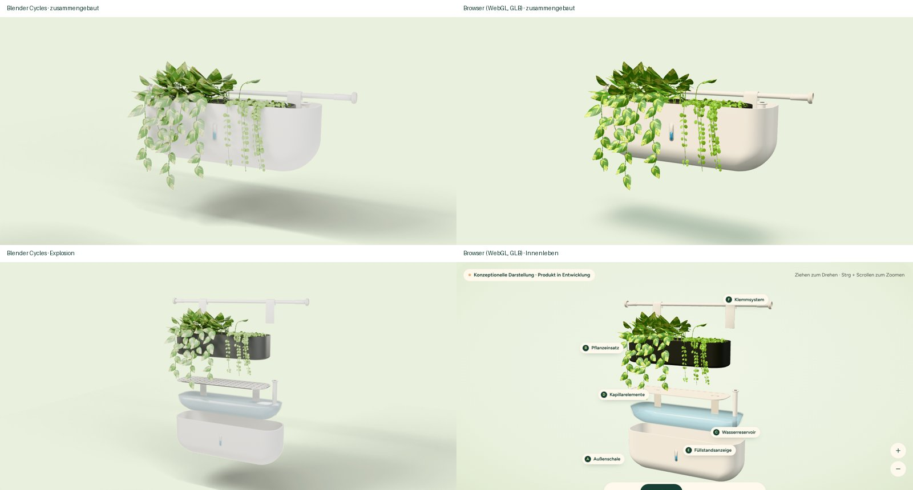

# 3D-Bericht v5: Mastermodell, Pipeline, Qualitätstor

Stand: 9. 11. 2026 · Viewer im Abschnitt „Schön von außen. Durchdacht von innen.“

## Kurzfassung

- **Ein Modell für alles:** `blender/stadtgarden_v5.py` baut das Konzeptmodell in Blender (bpy 5.2.3). Daraus entstehen die Cycles-Standbilder und das GLB für den Browser.
- **Geometrie wie festgelegt:** eine Spannstange, zwei runde Endkappen, zwei breite Halterungen (Bänder über der Stange), keine J-Haken. Außenschale, Reservoir, gelochte Trennplatte, zwei Kapillarelemente, Pflanzeinsatz mit Erde, Sichtfenster.
- **Browser:** `public/models/stadtgarden.glb`, 521 KB (Meshopt-Geometrie, WebP-Texturen). Geladen erst, wenn der Abschnitt näher als 60 % einer Bildschirmhöhe ist.
- **Ehrliches Ergebnis:** Das Modell ist klar dasselbe Produkt wie auf den Fotos. Es ist **nicht fotorealistisch**. Die Pflanzen sind prozedural (keine lizenzierten Scans erreichbar) und wirken aus der Nähe wie gute Spielgrafik, nicht wie Fotografie. Das Foto-Ziel („perfektes Produktfoto“) erfüllen weiterhin die Fotos im Hero, Reveal und Abschluss.

## Pipeline

```
blender/textures.py        → blender/tex/*.png   (prozedurale Texturen, frei verwendbar)
blender/stadtgarden_v5.py  → Szene, PBR-Materialien, Pflanzen
   --glb  public/models/stadtgarden-raw.glb       (glTF, Y oben)
   --render renders/…png --state assembled|exploded   (Cycles, Kamera = Viewer)
gltf-transform optimize --compress meshopt --texture-compress webp
   → public/models/stadtgarden.glb
```

Ein Befehl für alles: `scripts/build-model.sh` (benötigt `pip install bpy` und `npx @gltf-transform/cli`).

Der Viewer (`components/explorer/PlanterScene.tsx`) übernimmt Geometrie und Materialien aus dem GLB und ergänzt nur, was zur Interaktion gehört: Schnittebene, Wasserpartikel, Pfeile, Fensterlaibung in der Montage-Ansicht, Beschriftungen.

Drei Korrekturen beim Laden, weil der glTF-Export sie nicht so liefert wie gebraucht:

| Problem | Ursache | Lösung im Viewer |
| --- | --- | --- |
| Lochraster und Erde wiederholten sich nicht | Export setzt Texturen auf „clamp“ | alle Texturen auf `RepeatWrapping` |
| Löcher der Trennplatte verschwinden aus der Entfernung | Mipmaps mitteln Loch und Platte | Plattentextur ohne Mipmaps, größere Löcher |
| Blätter mit Sortierfehlern | Export als `BLEND` | `alphaTest 0.5`, auf starken Geräten zusätzlich `alphaToCoverage` |

## Vier Ansichten

| Ansicht | Was passiert | Geprüft |
| --- | --- | --- |
| Produkt | zusammengebaut, Stange mit Halterungen, frei drehbar | 1440 und 390 px |
| Innenleben | Explosionsansicht, Schieberegler, Teileliste A–F, Teile einzeln herausziehbar | 1440 und 390 px |
| Wasserweg | Schnitt durch Schale und Reservoir, Tropfen steigen in den Kapillarelementen, drei nummerierte Schritte | 1440 und 390 px; ohne Schleife bei „Bewegung reduzieren“ |
| Montage | Fensterlaibung blendet ein, Stange teleskopiert bis zur Laibung, Pflanzen treten zurück | 1440 und 390 px |

Beschriftungen bleiben auf schmalen Bildschirmen ganz im Bild (seit dieser Runde begrenzt).

## Qualitätstor: Cycles gegen Browser



Links Blender Cycles (128 Samples, Denoiser, AgX), rechts dasselbe Modell im Browser (WebGL, Software-Rendering im Test). Kamera identisch (vertikaler Bildwinkel 30°).

| Kriterium | Cycles | Browser | Urteil |
| --- | --- | --- | --- |
| Form der Schale, Proportionen | ✔ | ✔ | gleich |
| Spannstange, Endkappen, breite Halterungen | ✔ | ✔ | gleich, keine Haken |
| Sichtfenster mit Wasserstand | ✔ | ✔ | gleich |
| Lochraster der Trennplatte | gut sichtbar | in der Explosion aus der Entfernung kaum sichtbar | Schwäche im Browser |
| Pflanzen | weich, aber blass (Studiolicht zu hell) | sattere Farben, schärfere Kanten, sichtbare Kartengeometrie aus der Nähe | beide **nicht fotoreal** |
| Licht, Schatten | weiche Flächenlichter, echter Schattenwurf | Umgebungslicht + eine Schattenkarte, Kontaktschatten | Browser härter, aber stimmig |
| Material der Schale | satiniert, etwas grau | warmes Weiß mit leichtem Glanz | Browser näher an den Fotos |

**Entscheidung:** Das Standbild, das vor dem Laden des 3D-Modells an derselben Stelle steht (`public/images/viewer-preview-*.webp`), ist jetzt eine Aufnahme aus dem Browser-Viewer selbst und nicht mehr das Cycles-Bild. Grund: Der Wechsel vom blassen Cycles-Bild zum satteren 3D-Modell war deutlich sichtbar. Jetzt deckt sich das Standbild pixelgenau mit dem ersten 3D-Bild (geprüft bei 1440 und 390 px).

## Fallbacks und Robustheit

| Fall | Verhalten | Geprüft |
| --- | --- | --- |
| vor dem Laden | Standbild aus dem Viewer, gleiche Kamera | ja |
| kein WebGL | Konzept-Explosionsbild, Hinweis „Dein Browser zeigt kein 3D …“, nur „Produkt“ wählbar | ja (Chromium ohne WebGL) |
| GLB lädt nicht (Netz, Datei fehlt) | **vorher stürzte die ganze Seite ab** („Application error“); jetzt fängt eine Fehlergrenze das ab und zeigt das Bild mit Hinweis | ja (Anfrage blockiert) |
| schwaches Gerät (≤ 4 Kerne, ≤ 4 GB, Datensparmodus) | weniger Pixel, keine Schattenkarte, weniger Tropfen | Logik geprüft, nicht auf echtem Gerät |
| „Bewegung reduzieren“ | keine Kamerafahrten, Wasserweg ohne Schleife, kein Abspielknopf | ja |

## Grenzen und nächste Schritte

1. **Fotorealistische Pflanzen** brauchen gescannte oder professionell modellierte Assets (z. B. lizenzierte Efeutute und Pfennigkraut). Poly Haven war aus der Arbeitsumgebung gesperrt, bei Khronos gibt es keine passende Pflanze. Mit solchen Assets bleibt die Pipeline gleich; nur die Pflanzenfunktion im Blender-Skript wird ersetzt.
2. **Lochraster in der Explosion:** echte Löcher in der Geometrie statt Textur (mehr Dreiecke, aber aus jeder Entfernung sichtbar).
3. **Test auf echter Hardware:** alle Browser-Aufnahmen entstanden mit Software-Rendering (SwiftShader). Auf echten GPUs sind Kanten glatter und Übergänge schneller; Bildrate, Akku und Wärme auf echten Handys sind **ungeprüft**.
4. **Cycles-Licht:** Studiolicht und Belichtung so anpassen, dass die Standbilder für Presse oder Social Media nicht blass wirken.
